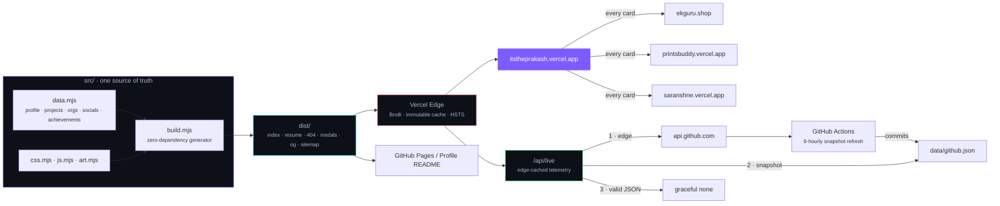

<div align="center">


<br/>

<a href="https://itstheprakash.vercel.app"></a>
<a href="mailto:itsThePrakash@gmail.com"></a>
<a href="https://itstheprakash.vercel.app/resume"></a>

<br/><br/>

```
$ whoami
────────────────────────────────────────────────────────────────────
  name             ·  Prakash Gothwal   (@itsThePrakash)
  role             ·  Founder & CEO @ EkGuru · Full-Stack & AI Engineer
  alma mater       ·  MNIT Jaipur — B.Tech CSE, 2022–2026
  schooling        ·  Class X 2020 · Class XII 2022
  home             ·  Kolwa, Dausa, Rajasthan
  location         ·  Jaipur, Rajasthan, India   (IST · UTC+5:30)
────────────────────────────────────────────────────────────────────
  ▸ ekguru.shop                 ▸ printsbuddy.vercel.app
  ▸ saranshne.vercel.app        ▸ itstheprakash.vercel.app/about
```

</div>

---

## About me

> *Small sites, plain HTML, and things that stay up.*

I'm **Prakash Gothwal**, usually just Prakash. I'm from Kolwa, a village in Dausa district, Rajasthan, and I studied CSE at MNIT Jaipur from 2022 to 2026. I started **EkGuru**, a Hindi learning site with 2,754 static pages and 31 language bridges, and **Print$Buddy**, a print delivery service for hostel rooms that I ran through college.

You'll also find me as **Prakash MNIT**, **Prakash CSE**, **Prakash Kolwa** or **Prakash Dausa**. Same person. There is a longer bio at [itstheprakash.vercel.app/about](https://itstheprakash.vercel.app/about).

My house style: **zero dependencies, zero framework runtimes, sub-second first paint, and a fallback for every link in the chain.** My portfolio is generated from one data file by a dependency-free Node build — <kbd>node src/build.mjs</kbd>, nothing else. This README mirrors the same links.

---

## Deployments and archives

<table>
<tr>
<td width="50%" valign="top">

### 🟣 [EkGuru](https://ekguru.shop) — *Founder &amp; CEO*
**A language bridge that turns Hindi into a door, not a wall.**
2,754 hand-tuned static pages · 11 locale directories · 31 "learn Hindi for *your* language" bridges · spaced repetition · voice practice · offline PWA · **zero framework runtime.**
<sub>HTML · CSS · JS · Python · Service Worker</sub>

<br/>

### 🔵 [EkGuru Questions](https://ekguru-questions.vercel.app) — *Exam engine* · [Pages](https://ekgurulearning.github.io/Questions-/)
**A CBT platform that survives a whole campus sitting an exam at once.**
All-subject computer-based tests, server-rendered results, Supabase backend, CI-gated content pipeline.
<sub>Node.js · Supabase · PostgreSQL · CI/CD</sub>

<br/>

### 🩷 [Print$Buddy](https://printsbuddy.vercel.app) — *Founder* · [Pages](https://print-buddy.github.io/PrintsBuddy/)
**Born at 1 a.m. in a boys hostel. Print delivered to your door.**
**Archived — permanently closed after graduation; the site stays up as a record.**
Order tracking, payments, an admin console, a wall-of-buddy leaderboard and two built-in study-break games. MNIT Jaipur campus.
<sub>HTML · CSS · JavaScript · Vercel</sub>

</td>
<td width="50%" valign="top">

### 🟢 [Saransh](https://saranshne.vercel.app) — *AI summarizer*
**Long documents in, clean structured digests out.** Gemini-powered: key points, tone, reading time.
<sub>TypeScript · Gemini API</sub>

<br/>

### 🟡 [TANIK News India](https://tanik-news-india.vercel.app) — *AI newsroom*
**India-focused news, curated and rewritten into scannable briefs** with category filtering and a fast static shell.
<sub>TypeScript · Gemini API</sub>

<br/>

### 🟠 [PDF Forensics](https://github.com/itsThePrakash/PDF-Forensics-) · [Pages](https://itstheprakash.github.io/PDF-Forensics-/) — *Major project*
**Read the metadata nobody thinks to check.** Metadata extraction, anomaly detection, structure inspection, generated reporting.
<sub>Python · TypeScript</sub>

<br/>

### 🔴 [Astro × Supabase Starter](https://github.com/itsThePrakash/astro-supabase-starter) — *Open source*
**Ship a full-stack Astro app with a database in one click.** MIT licensed.
<sub>Astro · Supabase · TypeScript</sub>

</td>
</tr>
</table>

<sub>**Verified GitHub Pages builds:** [EkGuru](https://ekguru.shop/) · [EkGuru Questions](https://ekgurulearning.github.io/Questions-/) · [Print$Buddy](https://print-buddy.github.io/PrintsBuddy/) · [PDF Forensics](https://itstheprakash.github.io/PDF-Forensics-/) · [ID Maker](https://itstheprakash.github.io/id-maker/) · [Triyal](https://itstheprakash.github.io/triyal/). These are the only repos with a GitHub Pages build; `astro-supabase-starter` is **not** on Pages — it runs on Netlify.</sub>

---

## Organisations

| Organisation | My role | Public repos |
|---|---|---|
| **[EkGuruLearning](https://github.com/EkGuruLearning)** | Founder &amp; CEO | [EkGuru](https://ekguru.shop) · [Questions-](https://ekguru-questions.vercel.app) |
| **[Print-Buddy](https://github.com/Print-Buddy)** | Founder | [PrintsBuddy](https://printsbuddy.vercel.app) |

<details>
<summary><b>More public repositories</b> <sub>(resume parsing, ID maker, PDF tools, DSA vault, starters)</sub></summary>
<br/>

| Project | What it is | Stack | Source |
|---|---|---|---|
| **Resume Parsing System** | ML pipeline: unstructured CVs → normalized records, scored and deduped | Python · spaCy · scikit-learn | [repo](https://github.com/itsThePrakash/Resume-Parsing-System) |
| **ID Maker** | Zero-dependency browser ID-card generator with live preview | HTML · CSS · JS | [repo](https://github.com/itsThePrakash/id-maker) · [pages](https://itstheprakash.github.io/id-maker/) |
| **ClassX PDF Download** | Retrieves view-restricted course PDFs for offline study | JavaScript · Node.js | [repo](https://github.com/itsThePrakash/ClassX-Pdf-download) |
| **View-Only PDF Download** | Companion tool for locked document viewers — no server | JavaScript | [repo](https://github.com/itsThePrakash/how-to-download-View-only-pdf) |
| **C++ · DSA Vault** | Every data structure and algorithm I've implemented, kept honest | C++ · STL | [repo](https://github.com/itsThePrakash/C-PLUS-PLUS) |
| **Astro Platform Starter** | Static-first Astro starter with content collections | Astro | [repo](https://github.com/itsThePrakash/astro-platform-starter) |
| **EkGuru Questions** | The CBT/results engine behind the exam platform | Node · Supabase | [repo](https://github.com/EkGuruLearning/Questions-) |
| **itsThePrakash** | This repo — the profile README and the build that generates my site | Node · zero deps | [repo](https://github.com/itsThePrakash/itsThePrakash) |

</details>

---

## GitHub achievements

**4 of 12 unlocked.** Each row below was verified against my live profile, with the real unlock timestamp and the exact event that triggered it.

<table>
<tr>
<td align="center" width="25%">


**🦈 Pull Shark**
<sub>`Default` · unlocked 2026-04-06</sub>
<sub>*"Opened pull requests that have been merged."*</sub>
<sub>proof · 2nd pull request merged</sub>

</td>
<td align="center" width="25%">


**👥 Pair Extraordinaire**
<sub>`Default` · unlocked 2026-04-16</sub>
<sub>*"Coauthored commits on merged pull requests."*</sub>
<sub>proof · co-authored with @google-labs-jules</sub>

</td>
<td align="center" width="25%">


**⚡ Quickdraw**
<sub>`Default` · 100% unlocked · 2025-08-23</sub>
<sub>*"Gitty up!"*</sub>
<sub>proof · closed `id-maker#1` within 5 minutes</sub>

</td>
<td align="center" width="25%">


**🚀 YOLO**
<sub>`Default` · 100% unlocked · 2025-08-23</sub>
<sub>*"You want it? You merge it."*</sub>
<sub>proof · merged `id-maker#2` without a review</sub>

</td>
</tr>
</table>

<details open>
<summary><b>Tier ladder — where I am on each one</b></summary>
<br/>

| Achievement | Default | 🥉 Bronze | 🥈 Silver | 🥇 Gold | My position |
|---|---|---|---|---|---|
| 🦈 **Pull Shark** | 2 merged PRs | 16 | 128 | 1024 | `2 / 16` → **Default** |
| 👥 **Pair Extraordinaire** | 1 co-authored PR | 10 | 24 | 48 | `1 / 10` → **Default** |
| ⚡ **Quickdraw** | 1 | — | — | — | ✅ done |
| 🚀 **YOLO** | 1 | — | — | — | ✅ done |
| ⭐ **Starstruck** | 16 ★ | 128 | 512 | 4096 | `1 ★` on best repo → **15 to go** |
| 🧠 **Galaxy Brain** | 2 accepted answers | 8 | 16 | 32 | `0` → locked |
| 💖 **Public Sponsor** | 1 sponsorship | — | — | — | locked |
| 🧙 **Open Sourcerer** | 1 external merge | 16 | 128 | — | locked |

</details>

<details>
<summary><b>Still locked</b> <sub>(thresholds are GitHub's own)</sub></summary>
<br/>

| | Badge | Unlock condition | Tiers |
|---|---|---|---|
| ⭐ | **Starstruck** | A repo you own collects stars | 16 · 128 · 512 · 4096 |
| 🧠 | **Galaxy Brain** | A Discussions reply is marked the accepted answer | 2 · 8 · 16 · 32 |
| 💖 | **Public Sponsor** | Sponsor an open-source contributor via GitHub Sponsors | single tier |
| 🧙 | **Open Sourcerer** | Get PRs merged into public repos you don't own | 1 · 16 · 128 |
| ❤️ | **Heart On Your Sleeve** | Undocumented by GitHub — currently unobtainable | unpublished |
| 🧊 | **Arctic Code Vault** | Contributed to a repo archived in the 2020 Arctic Vault | single tier |
| 🔴 | **Mars 2020 Contributor** | Contributed to the Ingenuity helicopter repo | single tier |
| 🌟 | **GitHub Star** | Nominated by GitHub as a community Star | single tier |

</details>

---

## GitHub stats

<div align="center">


<br/>


</div>

> The numbers on my [portfolio](https://itstheprakash.vercel.app) are fetched live from the GitHub REST API through an edge-cached function, then fall back to a build-time snapshot, then to the browser talking to GitHub directly — so they're never wrong and never slow.

---

## Stack

<p>


</p>
<p>


</p>
<p>


</p>
<p>


</p>

---

## Links

<div align="center">

<table>
<tr>
<td align="center" width="25%"><a href="https://github.com/itsThePrakash"></a><br/><sub>@itsThePrakash</sub></td>
<td align="center" width="25%"><a href="https://www.linkedin.com/in/itsThePrakash"></a><br/><sub>in/itsThePrakash</sub></td>
<td align="center" width="25%"><a href="https://twitter.com/itsThePrakash"></a><br/><sub>@itsThePrakash</sub></td>
<td align="center" width="25%"><a href="https://www.instagram.com/its.the.prakash"></a><br/><sub>@its.the.prakash</sub></td>
</tr>
<tr>
<td align="center"><a href="https://youtube.com/@itstheprakash"></a><br/><sub>@itstheprakash</sub></td>
<td align="center"><a href="https://www.geeksforgeeks.org/profile/istheprakash"></a><br/><sub>istheprakash</sub></td>
<td align="center"><a href="https://t.me/Prakash_gothwal"></a><br/><sub>@Prakash_gothwal</sub></td>
<td align="center"><a href="https://www.facebook.com/itsThePrakash1"></a><br/><sub>itsThePrakash1</sub></td>
</tr>
<tr>
<td align="center"><a href="https://dev.to/itstheprakash"></a><br/><sub>@itstheprakash</sub></td>
<td align="center"><a href="mailto:itsThePrakash@gmail.com"></a><br/><sub>itsThePrakash@gmail.com</sub></td>
<td align="center"><a href="https://buymeacoffee.com/itsThePrakash"></a><br/><sub>buymeacoffee.com/itsThePrakash</sub></td>
</tr>
</table>

</div>

---

## How this is built



<div align="center">
<sub>One data file in, a portfolio + a résumé + a profile README out. No framework, no runtime, no supply chain.</sub>
</div>

---

<div align="center">

**Currently:** grinding toward <mark>⭐ Starstruck</mark> — 1 star on my best repo, 15 to go.
If something here helped you, a star on any repo genuinely moves the number.

<br/>


<br/><br/>

<sub>Built with zero dependencies · served from the edge · every link has a fallback</sub><br/>
<sub>Jaipur, India · <code>IST</code> · <a href="https://itstheprakash.vercel.app">itstheprakash.vercel.app</a></sub>

</div>
