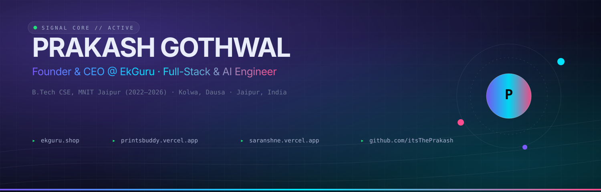
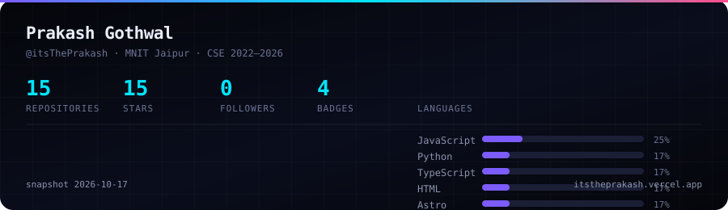
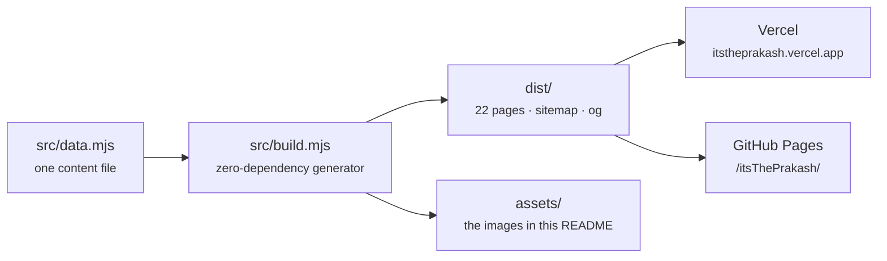

<div align="center">



<br/>

### Prakash Gothwal

B.Tech CSE, MNIT Jaipur · Kolwa, Dausa → Jaipur · Founder of EkGuru

[**Portfolio**](https://itstheprakash.vercel.app) · [**Résumé**](https://itstheprakash.vercel.app/resume) · [**About**](https://itstheprakash.vercel.app/about) · [**All projects**](https://itstheprakash.vercel.app/projects) · [**Sponsor**](https://itstheprakash.vercel.app/sponsor) · [**itsThePrakash@gmail.com**](mailto:itsThePrakash@gmail.com)

</div>

---

I write small web things and keep them alive. No framework runtimes, no analytics, no build step that needs a team to maintain. Everything here is hand-written or generated by a generator I wrote myself.

I finished school in Kolwa, a village in Dausa district, in 2020 and 2022, then moved to Jaipur for a B.Tech in Computer Science at MNIT. I graduated in 2026. Along the way I started **EkGuru**, a Hindi-first learning site, and **Print$Buddy**, a print delivery service for hostel rooms that I ran through college and closed after graduating.

You might find me as **Prakash MNIT**, **Prakash CSE**, **Prakash Kolwa** or **Prakash Dausa**. Same person. The long version is on the [about page](https://itstheprakash.vercel.app/about).

## What I'm building

| | Project | What it does | Stack |
|---|---|---|---|
| **●** | **[Bhasha Bridge](https://bhashabridge-iota.vercel.app)** | A language-learning web app — Google sign-in, Postgres behind the lessons, email for account flows. Newest build. | Next.js · Postgres · Vercel |
| **●** | **[EkGuru](https://ekguru.shop)** | Hindi for people who don't speak English first. 2,754 static pages, 11 locales, 31 "learn Hindi for your language" bridges. | HTML · CSS · JS · Python |
| **●** | **[EkGuru Questions](https://ekguru-questions.vercel.app)** | The exam engine behind EkGuru — computer-based tests and results, built for one campus sitting an exam at once. | Node · Supabase · Postgres |
| **●** | **[Saransh](https://saranshne.vercel.app)** | Long document in, short digest out: key points, tone, reading time. | TypeScript · Gemini |
| **●** | **[TANIK News India](https://tanik-news-india.vercel.app)** | Indian news rewritten into short, scannable briefs, filtered by category. | TypeScript · Gemini |
| **●** | **[PDF Forensics](https://itstheprakash.github.io/PDF-Forensics-/)** | Reads the metadata nobody checks — anomalies, structure, generated report. | Python · TypeScript |
| **○** | **[Print$Buddy](https://printsbuddy.vercel.app)** | Printed pages delivered to hostel rooms. Closed after graduation; the site stays up as a record. | HTML · JS · Vercel |

<sub>● live · ○ closed</sub>

<details>
<summary><b>Everything else</b> — 9 more repositories</summary>
<br/>

| Project | What it is | Source |
|---|---|---|
| **Resume Parsing System** | ML pipeline: messy CVs in, normalised and deduplicated records out | [repo](https://github.com/itsThePrakash/Resume-Parsing-System) |
| **ID Maker** | Zero-dependency ID-card generator, live preview in the browser | [repo](https://github.com/itsThePrakash/id-maker) · [demo](https://itstheprakash.github.io/id-maker/) |
| **ClassX PDF Download** | Pulls view-restricted course PDFs for offline study | [repo](https://github.com/itsThePrakash/ClassX-Pdf-download) |
| **View-Only PDF Download** | Companion tool for locked document viewers, no server | [repo](https://github.com/itsThePrakash/how-to-download-View-only-pdf) |
| **C++ / DSA Vault** | Every data structure and algorithm I've implemented | [repo](https://github.com/itsThePrakash/C-PLUS-PLUS) |
| **Astro × Supabase Starter** | Full-stack Astro starter with a database, MIT licensed | [repo](https://github.com/itsThePrakash/astro-supabase-starter) |
| **Astro Platform Starter** | Static-first Astro starter with content collections | [repo](https://github.com/itsThePrakash/astro-platform-starter) |
| **Triyal** | Early Print$Buddy build | [repo](https://github.com/itsThePrakash/triyal) |
| **awesome-piracy** | A fork I keep around for reference | [repo](https://github.com/itsThePrakash/awesome-piracy-) |

</details>

## Organisations

| Organisation | My role | Repositories |
|---|---|---|
| **[EkGuruLearning](https://github.com/EkGuruLearning)** | Founder & CEO | [EkGuru](https://github.com/EkGuruLearning/EkGuru) · [Questions-](https://github.com/EkGuruLearning/Questions-) |
| **[Print-Buddy](https://github.com/Print-Buddy)** | Founder | [PrintsBuddy](https://github.com/Print-Buddy/PrintsBuddy) |

## Numbers

<div align="center">

</div>

<sub>Pulled from the GitHub API into a build-time snapshot, not typed by hand. `0` followers is real too — I'd rather show the number than hide it.</sub>

## What I've unlocked

4 of GitHub's 12 profile badges. The rest are thresholds I haven't reached.

<table>
<tr>
<td align="center" width="25%"><br/><b>Pull Shark</b><br/><sub>2 merged pull requests<br/>2026-04-06</sub></td>
<td align="center" width="25%"><br/><b>Pair Extraordinaire</b><br/><sub>co-authored PR merged<br/>2026-04-16</sub></td>
<td align="center" width="25%"><br/><b>Quickdraw</b><br/><sub>issue closed in 5 minutes<br/>2025-08-23</sub></td>
<td align="center" width="25%"><br/><b>YOLO</b><br/><sub>merged without review<br/>2025-08-23</sub></td>
</tr>
</table>

## Tools I actually use

`C++` `Python` `TypeScript` `JavaScript` `HTML` `CSS` `SQL` `Bash` · `React` `Astro` `Tailwind` `Node.js` `Supabase` `PostgreSQL` `MongoDB` · `Gemini API` `scikit-learn` `spaCy` `Pandas` · `Git` `GitHub Actions` `Vercel` `Linux` `Postman`

## Sponsor

Everything on the site is free: no ads, no trackers, no paywall, no email capture. If one of these tools saved you an afternoon, you can [sponsor the work](https://itstheprakash.vercel.app/sponsor). Any amount, one time or monthly, through GitHub Sponsors — it works for Indian bank accounts and pays out in rupees.

Sponsors get their name on the wall, and only if they want it there. The list below is generated from `SPONSOR.wall` in `src/data.mjs` and rendered on both the site and this README, so the two can never drift apart. Nothing gets locked behind a payment.

<!-- SPONSORS:START -->
_Nobody yet. The first name goes here._
<!-- SPONSORS:END -->

## Find me

[GitHub](https://github.com/itsThePrakash) · [LinkedIn](https://www.linkedin.com/in/itsThePrakash) · [X](https://twitter.com/itsThePrakash) · [Instagram](https://www.instagram.com/its.the.prakash) · [YouTube](https://youtube.com/@itstheprakash) · [Dev.to](https://dev.to/itstheprakash) · [Telegram](https://t.me/Prakash_gothwal) · [GeeksforGeeks](https://www.geeksforgeeks.org/profile/istheprakash) · [Facebook](https://www.facebook.com/itsThePrakash1) · [Email](mailto:itsThePrakash@gmail.com)

## How this is built



One data file in: the portfolio, a résumé, an about page, a sponsor page, a page per project, a page per repository, and this README. No framework, no runtime, no supply chain. Every image on this page is generated by the same build and committed to `assets/`, so nothing here depends on a third-party stats service staying alive.

```bash
npm run build     # → dist/ + assets/
npm run verify    # tag balance, internal links, inline JS, size budget
npm run dev       # local preview on :4173
```
